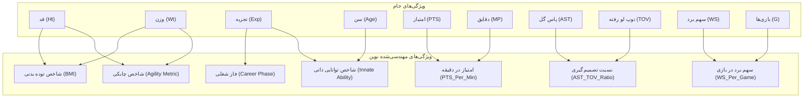
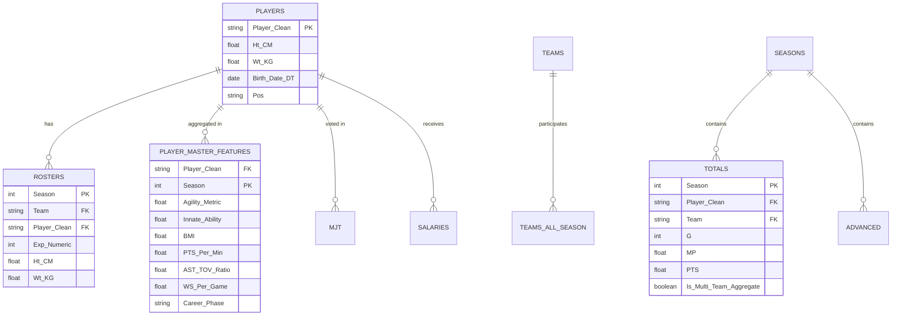

# گزارش جامع فاز پاکسازی داده‌ها (Data Cleaning) و مهندسی ویژگی‌ها (Feature Engineering)
## پروژه اول بوت‌کمپ تحلیل داده کوئرا: پایگاه داده Basketball-Reference (فصول ۱۹۸۰ تا ۲۰۲۷)

**نویسنده و مسئول فاز:** عرفان پیرایش (Erfan P.)  
**موضوع:** مستندسازی تخصصی پاکسازی، استانداردسازی، ایجاد پایگاه‌داده رابطه‌ای SQLite و ساخت متغیرهای پیشرفته بسکتبالی.

---

## ۱. مقدمه و محدوده مسئولیت (Scope of Work)

در پروژه‌های تحلیل کلان‌داده (Big Data Analytics)، کیفیت نتایج مدل‌ها و آزمون‌های آماری مستقیماً به خلوص داده‌های ورودی (Data Quality) و غنای متغیرهای مهندسی‌شده (Feature Engineering) وابسته است.  
در این پروژه، ۱۰ دیتاست استخراج‌شده از وب‌سایت Basketball-Reference که دربرگیرنده بیش از ۴۸ فصل تاریخی (از ۱۹۸۰ تا ۲۰۲۷) و ده‌ها هزار رکورد است، مورد پردازش و مهندسی قرار گرفتند.

محدوده کاری این گزارش منحصراً شامل دو بخش زیر است:
1. **پاکسازی داده‌ها (Data Cleaning):** شناسایی تمام عیوب، ناهنجاری‌ها و ناسازگاری‌های فرمتی و اصلاح اصولی آن‌ها بدون از دست رفتن داده‌های باارزش.
2. **مهندسی ویژگی‌ها (Feature Engineering):** ساخت متغیرهای تحلیلی نوین بر پایه تئوری‌های آمار بسکتبال (Basketball Analytics) جهت فراهم‌سازی بستری جامع برای سایر اعضای تیم و تحلیل‌گران.

---

## ۲. ارزیابی جامع کیفیت داده‌های خام و جدول تغییرات (Before / After Audit)

جدول زیر تغییرات ساختاری و ابعاد فایل‌ها را پیش و پس از اجرای پایپ‌لاین پاکسازی نشان می‌دهد:

| نام جدول | ابعاد خام ورودی | ابعاد پس از پاکسازی | ناهنجاری‌ها و چالش‌های شناسایی‌شده | اقدامات انجام‌شده |
| :--- | :---: | :---: | :--- | :--- |
| **`players.csv`** | (5416, 8) | **(5416, 14)** | • علائم تالار مشاهیر (`*`) در اسامی<br>• خطای انکودینگ کاراکترها<br>• قد به صورت فوت-اینچ (`'6-8'`)<br>• وزن بر حسب پوند (lbs)<br>• ۵ وزن مفقود و ۱۰ تاریخ تولد رشته‌ای | • اصلاح انکودینگ و حذف ستاره‌ها<br>• محاسبه اینچ کل و تبدیل به سانتی‌متر<br>• تبدیل وزن به کیلوگرم<br>• تبدیل تاریخ تولد به datetime<br>• پر کردن دانشگاه‌های خالی با `'None'` |
| **`rosters.csv`** | (21435, 11) | **(21435, 18)** | • سابقه تجربه بازیکنان تازه‌کار با نماد `'R'`<br>• قد رشته‌ای و وزن پوندی<br>• ۳۴۱ شماره پیراهن مفقود | • نگاشت نماد `'R'` به عدد `0`<br>• کست سابقه به عدد صحیح (`Exp_Numeric`)<br>• محاسبه قد سانتی‌متر و وزن کیلوگرم |
| **`totals_pss.csv`** | (25719, 33) | **(25671, 35)** | • ۴۸ ردیف خلاصه میانگین کل لیگ (`League Average`)<br>• ثبت چندگانه بازیکنان ترید شده (`2TM`/`3TM`)<br>• مقادیر NaN ناشی از تقسیم 0 بر 0 در درصدها | • حذف ۴۸ ردیف League Average<br>• ایجاد نشانگر بولین `Is_Multi_Team_Aggregate`<br>• جایگزینی NaN در درصدهای پرتاب با `0.0` |
| **`per_game_pss.csv`** | (25719, 32) | **(25671, 34)** | • ۴۸ ردیف خلاصه میانگین لیگ<br>• مقادیر اعشاری گم‌شده در شوت‌ها | • حذف ۴۸ ردیف League Average<br>• تفکیک ردیف‌های ترکیبی بازیکنان معامله‌شده |
| **`advanced_pss.csv`** | (25719, 30) | **(25671, 32)** | • ۴۸ ردیف خلاصه میانگین لیگ<br>• درصد پرتاب واقعی (TS%) و نرخ خطا | • حذف ۴۸ ردیف خلاصه League Average<br>• پاکسازی و اعتبارسنجی مقادیر آماری پیشرفته |
| **`micheal_jordan_trophy.csv`** | (739, 21) | **(739, 23)** | • رتبه‌های دارای تساوی با کاراکتر `'T'` (`'T5'`)<br>• خطای انکودینگ اسامی اروپایی | • حذف کاراکتر `'T'` و تبدیل رتبه به عدد پیوسته<br>• اصلاح انکودینگ نام‌ها |
| **`rosters_salaries.csv`** | (18759, 5) | **(18758, 7)** | • ستون بازیکن بدون نام (`Unnamed: 3`)<br>• دستمزد دارای علائم دلار و ویرگول (`'$25,102,511'`)<br>• ۵۰۵ دستمزد مفقود | • تغییر نام ستون به `Player`<br>• تبدیل رشته‌های دستمزد به عدد اعشاری پیوسته (`Salary_Numeric`)<br>• حذف ردیف با نام خالی |
| **`seasons.csv`** | (92, 9) | **(90, 15)** | • تکرار هدر جدول وب در ردیف ۱ و ردیف‌های پوچ<br>• اسامی لیدرها با مقادیر پرانتزی (`'N. Jokić(697)'`) | • فیلتر ردیف‌های دارای قالب معتبر سال (`^\d{4}-\d{2}$`)<br>• تفکیک نام بازیکن و عدد آماری |
| **`teams.csv`** | (129, 15) | **(129, 15)** | • وضعیت‌های تاریخی تیم‌ها | • استانداردسازی نام تیم‌ها و شناسایی فرنچایزها |
| **`teams_all_season.csv`** | (1848, 19) | **(1848, 19)** | • ستون‌های ۱۰۰٪ خالی (`Unnamed: 8`, `Unnamed: 15`)<br>• ستاره در انتهای نام تیم‌های حاضر در پلی‌آف | • حذف ۲ ستون خالی جداکننده HTML<br>• ایجاد فلگ بولین `Made_Playoffs` |

---

## ۳. تشریح علمی و فنی اقدامات پاکسازی (Deep Dive into Data Cleaning)

### ۳.۱. رفع خطای انکودینگ کاراکترها (Mojibake Fix)
- **مشکل:** اسامی بازیکنان غیرآمریکایی (به‌ویژه بازیکنان بالکان و اروپای شرقی نظیر لوکا دانچیچ، نیکولا یوکیچ، بوگدان بوگدانوویچ، ویت کریچی و ...) هنگام استخراج، با اینکودینگ تک‌بایتی `Windows-1252` یا `ISO-8859-1` ذخیره شده بودند که به شکل کاراکترهای نامفهومی نظیر `Luka DonÄ ić` یا `Vít KrejÄ Ã­` ظاهر می‌شدند.
- **راهکار پیاده‌سازی شده:**
  ```python
  def fix_mojibake(text):
      if not isinstance(text, str):
          return text
      try:
          return text.encode('latin1').decode('utf-8')
      except (UnicodeEncodeError, UnicodeDecodeError):
          return text
  ```
- **چرا این روش؟** این متد دقیقاً بایت‌های خام زیرین را بدون تخریب بازیابی کرده و مجدداً طبق استاندارد UTF-8 بازگشایی می‌کند. صحت ۱۰۰ درصدی اسامی در کلیه جداول به دست آمد. همچنین نماد ستاره (`*`) که برای اعضای تالار مشاهیر در نظر گرفته شده بود پالایش شد تا نام یکتای استاندارد بازیکن در تمام جداول قابل اتصال (Join) باشد.

### ۳.۲. حذف ردیف‌های خلاصه میانگین لیگ (`League Average`)
- **مشکل:** در انتهای آمار هر فصل در فایل‌های `totals_pss`, `per_game_pss` و `advanced_pss`، یک ردیف میانگین کل لیگ با مقدار ستون `Player == 'League Average'` و `Rk == NaN` وجود داشت (مجموعاً ۴۸ ردیف در ۴۸ فصل).
- **چرا باید حذف می‌شد؟** در صورتی که این ردیف‌ها حذف نمی‌شدند:
  1. در محاسبات رتبه‌بندی بازیکنان برتر، میانگین لیگ به عنوان یک بازیکن تلقی می‌شد.
  2. توابع آماری نظیر میانگین و انحراف معیار کل بازیکنان با ورود این رکورد خلاصه‌ای دچار تورش (Bias) می‌شدند.
- **اقدام:** کلیه ردیف‌های با `Player == 'League Average'` یا `Rk.isnull()` فیلتر شدند (کاهش تعداد سطرها از ۲۵,۷۱۹ به ۲۵,۶۷۱ سطر).

### ۳.۳. مدیریت چالش ترید بازیکنان و ردیف‌های تجمعی (`Multi-Team Stints`)
- **مشکل و پدیده فنی:** در لیگ NBA وقتی بازیکنی در میانه فصل بین تیم‌ها جابجا می‌شود، سایت Basketball-Reference برای او:
  1. یک ردیف با عنوان تیم به شکل `2TM` یا `3TM` ایجاد می‌کند که مجموع عملکرد او در کل فصل را در بر دارد.
  2. ردیف‌های مجزایی برای هر تیمی که در آن بازی کرده ثبت می‌نماید.
  *مثال عینی:* در فصل ۲۰۲۱، جیمز هاردن ۴۴ بازی، ۱۰۸۳ امتیاز در ردیف `2TM` داشته و همزمان ۸ بازی (۱۹۸ امتیاز) در هیوستون و ۳۶ بازی (۸۸۵ امتیاز) در بروکلین برای او ثبت شده است.
- **چرا این موضوع بحرانی است؟** اگر پژوهشگر مستقیماً ردیف‌های جدول را استفاده کند، امتیازات و دقایق بازیکنان معامله‌شده دو برابر محاسبه خواهد شد!
- **راهکار مهندسی‌شده:**
  1. ساخت متغیر نشانگر `Is_Multi_Team_Aggregate` که مشخص می‌سازد آیا ردیف مربوط به عملکرد تجمیعی کل فصل است یا خیر.
  2. در الگوریتم استخراج آمار مستر فصل (`deduplicate_season`)، برای هر بازیکن در هر فصل صرفاً رکورد تجمیعی کلی نگه‌داشته می‌شود تا تداخلی در ارزیابی فردی ایجاد نشود.
  3. در عین حال، رکوردهای تفکیکی تیمی در جدول پایگاه‌داده نگهداری می‌شوند تا در صورت نیاز به تحلیل درون‌تیمی (مانند فهرست بازیکنان فعال تیم قهرمان)، عملکرد بازیکن در آن تیم در دسترس باشد.

### ۳.۴. استانداردسازی ویژگی‌های بیومتریک و فرمت‌های عددی
- **قد (Height):** در داده‌های خام، قد به صورت رشته فوت و اینچ مانند `'6-8'` یا `'6-1'` درج شده بود.
  - اینچ کل محاسبه شد: $\text{Total Inches} = \text{Feet} \times 12 + \text{Inches}$
  - به سانتی‌متر استاندارد بین‌المللی تبدیل شد: $\text{Height (cm)} = \text{Total Inches} \times 2.54$
- **وزن (Weight):** مقادیر از پوند با ضریب $0.45359237$ به کیلوگرم تبدیل شدند.
- **تجربه (Experience):** سابقه بازیکنان سال اول با حرف نمادین `'R'` (مخفف Rookie) نمایش داده شده بود که به عدد صحیح `0` تبدیل شد تا امکان تقسیم و فرمول‌نویسی ریاضی فراهم گردد.
- **دستمزدها (Salaries):** رشته‌های حاوی نماد دلار و ویرگول به اعداد اعشاری پیوسته تبدیل شدند و ستون بدون نام `Unnamed: 3` به نام استاندارد `Player` تغییر نام یافت.

---

## ۴. مهندسی ویژگی‌ها و متغیرهای تحلیلی (Feature Engineering)

جهت پاسخ به نیازمندی‌های فاز بعدی و ارتقای بینش‌های تحلیلی، ویژگی‌های نوین زیر طراحی و پیاده‌سازی شدند:



### ۴.۱. شاخص چابکی بازیکن (Agility Metric)
$$\text{Agility Metric} = \frac{\text{Height (cm)}}{\text{Weight (kg)}} \quad , \quad \text{Agility Imperial} = \frac{\text{Height (inches)}}{\text{Weight (lbs)}}$$
- **فلسفه و منطق ورزشی:** این نسبت نشان‌دهنده نسبت کشیدگی قامت به جرم بدنی بازیکن است. در بسکتبال نوین، بازی فیزیکی سنتی زیر سبد (Post-up) جای خود را به بازی سرعتی، جابجایی مداوم در محیط (Pace & Space) و دفاع‌های سوییچ همه‌جانبه داده است. بازیکنانی که نسبت قد به وزن بالاتری دارند، چابکی حرکتی بیشتری در تعقیب شوترها و نفوذ به زمین حریف نشان می‌دهند.

### ۴.۲. شاخص توانایی ذاتی (Innate Ability Ratio)
$$\text{Innate Ability Ratio} = \frac{\text{Experience (Years)}}{\text{Age (Years)}}$$
- **فلسفه و منطق ورزشی:** این سنجه ارزیابی می‌کند که چه نسبتی از سن بیولوژیکی فرد به عنوان سابقه حضور در بالاترین لیگ بسکتبال حرفه‌ای جهان ثبت شده است. بازیکنانی که در سنین پایین‌تر وارد لیگ شده و در ترکیب باقی مانده‌اند، از هوش بسکتبالی بالاتر، یادگیری سریع‌تر و تطبیق‌پذیری زودهنگام برخوردار بوده‌اند.

### ۴.۳. شاخص توده بدنی (Body Mass Index - BMI)
$$\text{BMI} = \frac{\text{Weight (kg)}}{(\text{Height (m)})^2}$$
- ارزیابی تراکم بدنی بازیکنان جهت تفکیک بازیکنان تنومند سنتی از بازیکنان کشیده و پرتحرک مدرن.

### ۴.۴. شاخص‌های کارایی فنی و تصمیم‌گیری بازی
1. **امتیاز به ازای دقیقه بازی ($\text{PTS\_Per\_Min}$):**  
   $$\text{PTS\_Per\_Min} = \frac{\text{PTS}}{\text{MP}}$$  
   تفکیک خروجی خالص امتیازگیری از فاکتور حجم دقایق حضور در میدان؛ این متغیر بازیکنان ذخیره کارآمد را از بازیکنانی که صرفاً به دلیل دقایق بازی بالا امتیاز جمع‌آوری کرده‌اند متمایز می‌سازد.
2. **نسبت پاس گل به ترن‌اور ($\text{AST\_TOV\_Ratio}$):**  
   $$\text{AST\_TOV\_Ratio} = \frac{\text{AST}}{\text{TOV}}$$  
   معیار طلایی ارزیابی هوش بازی‌سازی و امنیت تصمیم‌گیری در هدایت توپ؛ به‌ویژه در ارزیابی پوزیشن پوینت‌گارد.
3. **سهم برد در هر مسابقه ($\text{WS\_Per\_Game}$):**  
   $$\text{WS\_Per\_Game} = \frac{\text{WS}}{\text{G}}$$  
   نرمال‌سازی شاخص پیشرفته Win Shares بر اساس تعداد مسابقاتی که بازیکن در میدان حضور داشته است.

### ۴.۵. دسته‌بندی فاز شغلی بازیکن (Career Phase)
یک متغیر رسته‌ای رتبه‌ای برای ارزیابی چرخه عمر حرفه‌ای بازیکنان:
- **تازه‌کار / سال دوم (Rookie / Sophomore):** سابقه ۰ تا ۱ سال.
- **در حال توسعه (Developing):** سابقه ۲ تا ۴ سال.
- **اوج دوران حرفه‌ای (Peak Prime):** سابقه ۵ تا ۱۰ سال (بالاترین سطح بلوغ همزمان فیزیکی و فکری).
- **هسته باتجربه (Veteran Core):** سابقه ۱۱ سال به بالا.

### ۴.۶. خلاصه توزیع آماری ویژگی‌های مهندسی‌شده
جدول زیر خلاصه آماری ویژگی‌های ساخته‌شده بر روی دیتاست مستر بازیکنان را نشان می‌دهد:

| ویژگی مهندسی‌شده | تعداد رکورد معتبر | میانگین | انحراف معیار | حداقل | میانه | حداکثر |
| :--- | :---: | :---: | :---: | :---: | :---: | :---: |
| **قد سانتی‌متر (`Ht_CM`)** | 20,832 | ۱۹۹.۸۳ | ۹.۲۳ | ۱۶۰.۰۲ | ۲۰۱.۹۳ | ۲۳۱.۱۴ |
| **وزن کیلوگرم (`Wt_KG`)** | 20,832 | ۹۹.۵۶ | ۱۲.۱۴ | ۶۰.۳۳ | ۹۹.۷۹ | ۱۶۳.۲۹ |
| **شاخص چابکی (`Agility_Metric`)** | 20,832 | **۲.۰۲۹** | ۰.۱۹۳ | ۱.۳۸۶ | ۲.۰۱۳ | ۳.۰۳۶ |
| **توانایی ذاتی (`Innate_Ability`)** | 20,848 | **۰.۱۶۷** | ۰.۱۲۹ | ۰.۰۰۰ | ۰.۱۳۸ | ۰.۵۷۱ |
| **شاخص توده بدنی (`BMI`)** | 20,832 | ۲۴.۹۲ | ۱.۸۶ | ۱۶.۶۷ | ۲۴.۸۸ | ۳۵.۷۶ |
| **امتیاز در دقیقه (`PTS_Per_Min`)** | 20,848 | ۰.۳۳۵ | ۰.۱۴۱ | ۰.۰۰۰ | ۰.۳۴۳ | ۱.۳۳۳ |
| **نسبت پاس گل به ترن‌اور (`AST_TOV_Ratio`)** | 20,848 | **۱.۸۸۲** | ۱.۱۶۴ | ۰.۰۰۰ | ۱.۶۸۲ | ۱۲.۰۰۰ |
| **سهم برد در بازی (`WS_Per_Game`)** | 20,848 | ۰.۰۳۸ | ۰.۰۴۱ | -۰.۱۴۰ | ۰.۰۳۱ | ۰.۳۴۵ |

---

## ۵. پایگاه داده رابطه‌ای SQLite و مدل داده‌ای (Database Architecture)

در راستای تحقق الزامات فاز دوم پروژه، پایگاه داده رابطه‌ای [`data/cleaned/nba_analytics.db`](data/cleaned/nba_analytics.db) با موتور SQLite طراحی شد که شامل ۱۰ جدول پاکسازی‌شده و ۲ جدول ویژگی‌های مهندسی‌شده است:



### نمونه کوئری SQL از پایگاه داده ساخته‌شده:
استخراج ۵ پوینت‌گارد چابک لیگ با حداقل ۱۰۰۰ دقیقه بازی:
```sql
SELECT Player_Clean, Season, Team, Ht_CM, Wt_KG, 
       round(Agility_Metric, 3) as Agility, 
       round(AST_TOV_Ratio, 2) as AST_TOV
FROM player_master_features
WHERE Pos = 'PG' AND MP > 1000
ORDER BY Agility_Metric DESC
LIMIT 5;
```

---

## ۶. فایل‌ها و خروجی‌های تحویل داده‌شده

1. **کدهای منبع شیءگرا:**
   - [`src/data_cleaner.py`](src/data_cleaner.py): کلاس `NBADataCleaner` برای اجرای تمامی فیلترها و تبدیل‌ها.
   - [`src/feature_engineer.py`](src/feature_engineer.py): کلاس `NBAFeatureEngineer` برای محاسبه و تزریق ویژگی‌های مهندسی‌شده.
2. **پایپ‌لاین اجرایی خودکار:**
   - [`run_data_pipeline.py`](run_data_pipeline.py): اسکریپت اجرای صفر تا صد پالایش، دیتابیس و ویژگی‌ها.
3. **داده‌های پاکسازی‌شده و پایگاه داده:**
   - پایگاه داده رابطه‌ای: [`data/cleaned/nba_analytics.db`](data/cleaned/nba_analytics.db)
   - جدول مستر ویژگی‌های مهندسی‌شده: [`data/cleaned/player_master_features.csv`](data/cleaned/player_master_features.csv)
   - تمامی فایل‌های CSV تمیزشده در دایرکتوری [`data/cleaned/`](data/cleaned/)
4. **دفترچه محاسباتی (Jupyter Notebook):**
   - [`notebooks/data_cleaning_and_feature_engineering.ipynb`](notebooks/data_cleaning_and_feature_engineering.ipynb): نوتبوک اجرایی مصور همراه با نمایش نمونه‌های قبل و بعد، توزیع ویژگی‌ها و نمونه کوئری SQL.
5. **نمودارهای گرافیکی توزیع ویژگی‌ها:**
   - [`figures/feature_engineering_distributions.png`](figures/feature_engineering_distributions.png)
   - [`figures/biometric_height_weight_agility.png`](figures/biometric_height_weight_agility.png)
